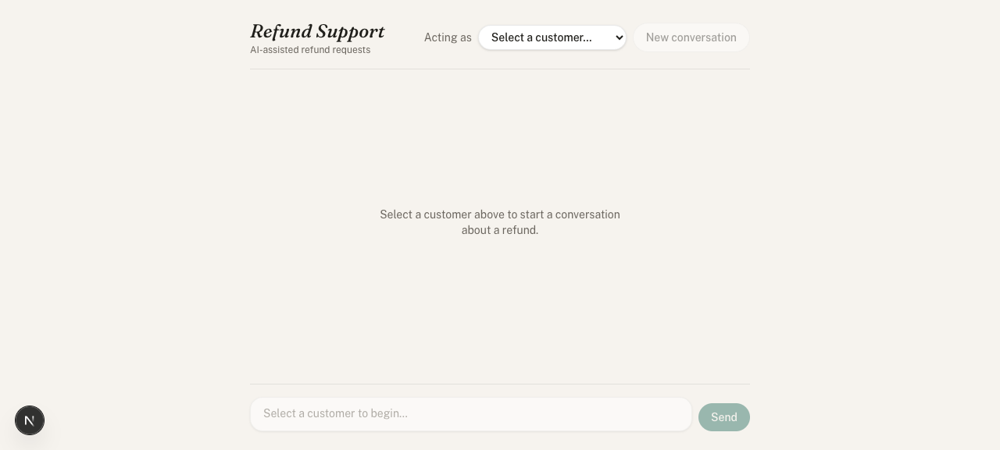
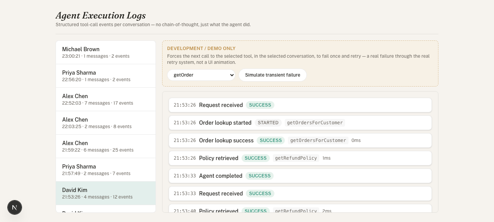

# Refund Support Agent

An AI customer support agent that handles e-commerce refund requests end to end: it talks to the customer, figures out which order they mean, checks that order against a real refund policy, and approves or denies the refund — with every step logged so you can see exactly what it did.

The LLM never decides policy. It calls tools, and the tools call deterministic backend code. If you disagree with a refund decision the agent gave, the bug is in the tool code, not in the prompt.

## Problem statement

Support teams get a lot of "can I get a refund" messages that all boil down to the same checks: is this order real, does it belong to this customer, is it still inside the refund window, is the category refundable, has it already been refunded. This project automates that triage with a conversational agent, while keeping the actual approve/deny decision in ordinary, testable backend code.

## Features

- Customer chat interface with message history, loading state, error state, and a distinct approve/deny decision card
- An "acting as" customer switcher standing in for login, since this project has no authentication layer
- A real agent that decides which tools to call and in what order, instead of a hardcoded script
- Six backend tools covering customer lookup, order lookup, policy retrieval, eligibility checking, and refund execution
- A deterministic, pure-function eligibility engine with six explicit reason codes
- Admin dashboard with a live (polling) execution log per conversation — timestamps, tool names, status, retry counts, durations
- A real retry system (linear backoff, two retries) plus a development-only control that forces one transient tool failure so you can watch it recover
- 40 automated tests across pure business logic, service integration, retry behavior, and a concurrency/race-condition regression test

## Architecture

```
Browser
  │
  ├── /            customer chat UI
  └── /admin        execution log dashboard
        │
        ▼
Next.js Route Handlers (Zod-validated)
        │
        ▼
Agent Orchestrator  ──calls──▶  Groq (Llama 3.3 70B, tool use)
        │
        ▼
Tool Layer (retry + structured logging wrapper around every tool)
        │
        ▼
Service Layer (all business logic, all Prisma access)
        │
        ▼
PostgreSQL
```

The LLM only ever sees tool interfaces — it never touches Prisma, never sees a connection string, and never computes a refund decision itself. Every tool call is independently re-validated server-side, so even a misbehaving or manipulated LLM response can't produce an incorrect refund: the worst it can do is call a tool with bad arguments, and the tool either handles that or returns a clear error.

## Tech stack

- Next.js 16 (App Router), TypeScript, Tailwind CSS 4
- PostgreSQL + Prisma 7 (driver adapter: `@prisma/adapter-pg`)
- Groq (`llama-3.3-70b-versatile`) via the OpenAI-compatible `groq-sdk`, for tool-calling
- Zod for request validation
- Vitest for tests

## Agent workflow

1. Customer sends a message.
2. The route handler loads the conversation's prior messages and appends the new one — no chat state lives anywhere except Postgres.
3. The orchestrator sends the full history plus the six tool definitions to Groq.
4. Groq decides which tool(s) to call, if any. The loop repeats — executing tools, feeding results back — until Groq returns a plain text answer or eight iterations pass (a hard cap against runaway loops).
5. Every tool call, retry, and outcome is written to the `AgentLog` table as it happens, not reconstructed afterward.
6. The final reply, plus a structured decision object if a refund was checked or processed, goes back to the browser.

There's no fixed sequence hardcoded into the orchestrator. For a customer with one order, the agent typically calls `getOrdersForCustomer` → `getRefundPolicy` → `checkRefundEligibility`, describes the order and asks the customer to confirm, then calls `processRefund` once they agree. For a customer with several orders, it asks which one first. That ordering comes from the system prompt and the tools' own descriptions, not from an if/else chain.

## Tool architecture

| Tool | What it does | Backed by |
|---|---|---|
| `getCustomer` | Returns the profile of the customer bound to this conversation. Takes no arguments — it cannot be pointed at another customer. | `customerService` |
| `getOrder` | Looks up one order by ID, scoped to the current customer. Returns not-found rather than leaking another customer's order. | `orderService` |
| `getOrdersForCustomer` | Lists the current customer's orders, for when they haven't named one. | `orderService` |
| `getRefundPolicy` | Returns the active policy record from the database — window, non-refundable categories, plain-language rules. | `refundPolicyService` |
| `checkRefundEligibility` | Read-only. Runs the real eligibility function and reports the result. | `refundService` + `eligibility.ts` |
| `processRefund` | Re-derives eligibility itself (never trusts a prior check), and only then mutates the order. | `refundService` |

Every tool is a thin wrapper: validate input with Zod, run the retry-wrapped service call, log the outcome. None of them import Prisma directly — only the service layer does.

`processRefund` is the one tool that changes data, and it's written to be safe even if called with no eligibility check beforehand — including under concurrent calls on the same order (see Known Limitations for how that's enforced).

## Refund policy

Stored in the database, not in the prompt:

- An order must exist and belong to the requesting customer.
- Refunds must be requested within 30 days of delivery.
- Digital Downloads and Perishables are non-refundable categories.
- An order that has already been refunded cannot be refunded again.
- The refund amount is always the original order amount — there is no partial refund and no way for a client or the model to supply a different amount.

`checkRefundEligibility` returns one of six reason codes: `OK`, `WINDOW_EXPIRED`, `NON_REFUNDABLE_CATEGORY`, `ALREADY_REFUNDED`, `ORDER_NOT_FOUND`, `CUSTOMER_MISMATCH`. It's a pure function with no I/O, so it's tested directly with plain objects — no database or mocking required.

## Database schema

Seven models:

- **Customer** — name, email, phone
- **Order** — belongs to a customer; product, category, amount, order/delivery dates, payment method, status (`PLACED` / `DELIVERED` / `REFUNDED`)
- **RefundPolicy** — versioned; window, non-refundable categories, active flag
- **RefundRequest** — one row per decision (approved or rejected), with the reason code and which policy version was used — a full audit trail, not just the latest state
- **Conversation** — belongs to a customer; this binding is the only thing standing in for authentication
- **Message** — plain role/content chat history per conversation
- **AgentLog** — one row per structured execution event (tool started, retried, succeeded, failed; policy retrieved; eligibility result; agent completed)

Indexes exist on every foreign key and every column actually filtered on (`Customer.email` unique, `RefundPolicy.version` unique, `AgentLog.conversationId` + `timestamp`, etc).

## Project structure

```
app/
  page.tsx                customer chat page
  admin/page.tsx          admin dashboard page
  api/
    chat/                 the main conversational endpoint
    conversations/        creates a Conversation for a chosen customer
    customers/             lists seeded customers for the selector
    admin/
      conversations/       list of conversations for the dashboard
      logs/                execution log for one conversation
      simulate-failure/    development-only: arms one forced tool failure
components/
  chat/                   chat UI
  admin/                  dashboard UI
  ui/                     shared button
lib/
  agent/
    orchestrator.ts        the tool-calling loop
    systemPrompt.ts
    tools/                 the six tools + the shared wrapper
    debugFailureInjection.ts
    errors.ts
  services/                all business logic, all Prisma access
  db/prisma.ts
  logging/agentLogger.ts
  validation/               Zod schemas
  retry.ts
  config/env.ts
prisma/
  schema.prisma
  seed.ts
tests/
  unit/                    pure functions, schemas, retry
  integration/              services, tools, concurrency, against a real test database
```

## Local setup

Requirements: Node 22+, npm, a local PostgreSQL server, a free Groq API key.

```
git clone <repo-url>
cd customer-support-agent
npm install
cp .env.example .env
```

### Environment variables

| Variable | Purpose |
|---|---|
| `DATABASE_URL` | Main Postgres connection string |
| `TEST_DATABASE_URL` | Separate database used only by integration tests, so tests never touch demo data |
| `GROQ_API_KEY` | Free key from console.groq.com/keys |
| `GROQ_MODEL` | Defaults to `llama-3.3-70b-versatile` |

### Database setup

```
createdb customer_support_agent
createdb customer_support_agent_test
npm run db:migrate
npm run db:seed
npm run test:db:setup
```

### Seed data

16 customers, 17 orders, one active refund policy. The seed data is intentional, not random — it includes at least two eligible orders, an expired-window order, a non-refundable-category order, an already-refunded order, and a customer with two orders (to exercise the "which order?" clarification). See Demo Scenarios below for exact names.

### Running the application

```
npm run dev
```

Chat UI at `localhost:3000`, admin dashboard at `localhost:3000/admin`.

## Testing

```
npm test
```

40 tests: pure eligibility logic (11 table-driven cases including the exact 30/31-day window boundary), customer/order service lookups, `processRefund` for every reason code, request validation, the retry helper, a live tool-failure/retry integration test, and a concurrency test that fires ten simultaneous `processRefund` calls at the same order and asserts exactly one succeeds.

## Demo scenarios

| Customer | Order | Scenario |
|---|---|---|
| Priya Sharma | Wireless Noise-Cancelling Headphones ($129.99) | Eligible |
| Alex Chen | Organic Cotton T-Shirt ($24.99) | Eligible |
| Maria Garcia | Portable Bluetooth Speaker ($59.99) | Refund window expired |
| James Wilson | Complete Web Development Course ($199.00) | Non-refundable category |
| Sarah Johnson | Trail Running Shoes ($89.99) | Already refunded (seeded pre-refunded) |
| David Kim | Mechanical Keyboard / USB-C Cable | Multiple orders — agent asks which one |

To see the retry system for real: open the admin dashboard, pick a conversation, arm a failure on any tool in the amber panel, then send a message in that conversation that would call it. The log shows the failure and the recovery as they actually happen.

## Deployment

Not deployed as part of this build. Frontend is a stock Next.js app (Vercel-ready); database would move to a hosted Postgres provider (Neon, Supabase). Left to whoever owns the credentials, since deploying requires accounts I don't have access to.

## Screenshots

Chat UI, no customer selected yet:



Admin dashboard, live execution log for a real conversation:



## Known limitations

- **No authentication.** "Acting as" is a dropdown, not a login. Anyone who knows a `conversationId` could message through it. This was scoped out deliberately, not overlooked — a real deployment would need actual sessions.
- **The admin dashboard is unauthenticated too.** Same reasoning as above; it would need a gate before being exposed publicly.
- **The underlying model is a free, smaller LLM (Llama 3.3 70B via Groq), not Claude.** It's noticeably less strict about tool-calling discipline than a frontier model — it will occasionally re-check an order that already has a settled outcome when the customer just says something like "thanks." This never produces a wrong or duplicate refund (the service layer re-derives eligibility and enforces atomicity independently of what the model does), but it can produce a slightly redundant reply. Tightened with explicit system-prompt instructions; not something prompting alone fully eliminates on this model.
- **Free-tier rate limits are real.** Groq's free tier caps at 100,000 tokens/day. Heavy manual testing can exhaust it for the rest of the day; the app handles this the same way it handles any LLM failure — a graceful "temporarily unavailable" message, not a crash.
- **No partial refunds.** By design — the assignment scope is a full refund of the original amount.

## Future improvements

- Real authentication and a scoped admin role
- WebSocket/SSE push for the admin log instead of polling, if the extra complexity is ever justified by scale
- A second, stricter model as a fallback path when the primary model's tool-calling gets unreliable
- Pagination on the admin conversation list past the current 50-row cap

## AI usage

This project was built with AI assistance (Claude, via Claude Code) across the full stack: architecture and schema design, the service and tool layers, the Next.js frontend, the test suite, and this README. The refund policy and eligibility logic were deliberately kept as plain, deterministic TypeScript specifically so the correctness of the core business logic doesn't depend on how the AI-assisted parts were written — it's independently testable and was tested, including a concurrency bug that live testing (not just code review) caught and fixed. The LLM integration itself (Groq/Llama) is the one part of the running application that is AI at request time; everything upstream of the refund decision is deterministic code that happens to have been written with AI help, the same as any other line in the repository.
